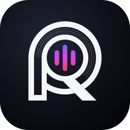
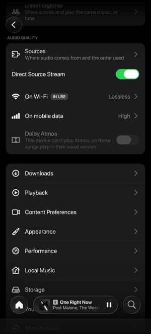

  
  <h1>ReChord</h1>
  
<strong>Music on your terms.</strong> A fast, audiophile-grade Android music player for YouTube Music, local libraries, and open custom audio sources.

  

    
    
    
    
  

  

    <a href="https://github.com/dabestakoh/ReChord/releases">Releases</a> ·
    <a href="https://github.com/dabestakoh/ReChord/actions/workflows/fidelity-ui-preview.yml">Preview Builds</a> ·
    <a href="https://github.com/dabestakoh/ReChord/issues">Issues</a> ·
    <a href="docs/RECHORD-STANDARDS.md">Engineering Standards</a>
  

## About

**ReChord** is an independently maintained fork of [BitChord](https://github.com/kushagrasinghx/BitChord) focused on expressive Now Playing skins, lossless audiophile playback, smarter lyrics timing, open custom add-on support, and smooth low-power performance.

ReChord is not affiliated with or endorsed by YouTube, Google, Spotify, Apple, Qobuz, or other music services.

---

## What's Different from BitChord

ReChord has evolved well beyond upstream BitChord across UI, playback fidelity, lyrics, add-ons, and performance:

| Area | ReChord Enhancements |
| --- | --- |
| **Now Playing Skins** | **3 dedicated skins** — **Default**, **Vinyl**, and **Poster** — each with dedicated **Portrait & Landscape** layouts, a quick **Rotate** button, bouncy spring controls, smooth background color melts, and unified full-width Queue/Lyrics. |
| **Vinyl Studio** | **16 realistic pressed-vinyl finishes** (including *Pinwheel*, *Tri-Color*, and *Gold Record*), live spinning preview, unobstructed center artwork, and a Hi-Fi machined tonearm with soft drop shadow, 3s progress peek, and pause needle lift. |
| **Expressive Poster** | Full-bleed edge-to-edge artwork, word-by-word expressive lyrics, curved seekbar with song-start peek, and an optional live **Curved Rim Visualizer** driven by a zero-allocation spectrum tap. |
| **Lyrics & Auto-Sync** | **Per-song saved lyrics offset**, **one-tap Auto-sync** (live vocal alignment with Undo), expanded lyric animations (*Rise & Glow*, *Shimmer Sweep*, *Word Lift*, *Plain Sweep*), smarter multi-provider matching, and clear provider statuses (*API key required* / *Unavailable*). |
| **Audiophile Pipeline & USB DACs** | **Fidelity Score**, detailed **Audio Pipeline** view (Source → App Output → Verified DAC Output), **Seamless Quality Upgrade** (OPUS → verified FLAC mid-track), FLAC read-ahead & cache reuse, automatic output precision, **Direct USB (`libusb 1.0.30`)** with optional software volume, and verified **PCM Preserved / Bit-Perfect** reporting. |
| **Open Custom Add-Ons** | **No BitChord device attestation required** for compatible custom add-on servers. Supports **bulk add-on URL import** and sends structured title/artist metadata for **Qobuz** and **MusicBrainz** add-ons while staying 100% compatible with query-only add-ons. |
| **Audio-First Video Mode** | Watch synchronized music videos in the Default skin **without downgrading your lossless FLAC audio**, with automatic fallback when no video is available. |
| **Local Music & Playlists** | Fast background-indexed **Local Music** (Songs, Albums, Artists, Album Artists, Folders, Playlists, Recently Added + A–Z jump rail), **import public playlists by link** (Apple Music, Spotify, YouTube Music), smart incremental playlist sync, and reliable playback restoration. |
| **Performance & Thermals** | True-black AMOLED theme, hardware-cached offscreen layers for smooth VSync-locked Vinyl spin, background-paused visualizer & throttled audio FFT, lighter scrolling glass controls, and opt-in redacted **Diagnostics** export. |

---

## Key Features

### Now Playing & Skins
- **Default, Vinyl, and Poster skins** — Switch anytime from **Settings → Appearance → Now Playing Skin** or by long-pressing the top handle in Now Playing.
- **Dedicated Landscape layouts** — Rotating sideways opens tailored widescreen layouts for Vinyl (full uncropped spinning record + tucked tonearm + centered controls) and Poster (edge-to-edge artwork + rising curved progress rim + centered controls).
- **Vinyl Studio** — Pick Black, Album-matched, or Custom dual-tone colors across 16 realistic finishes with pressed groove bands and beveled rims.
- **Audio-first Video Mode (Default)** — Play synchronized music videos alongside your existing high-resolution audio stream.

### Lyrics & Timing
- **Expressive word-synced lyrics** — Dynamic typography, duet alignment, and selectable lyric effects across all skins.
- **Per-song offset & one-tap Auto-sync** — Fine-tune timing per track without shifting other songs, or tap **Auto-sync** to align lyrics to live vocals with instant Undo.
- **Multi-provider intelligence** — Prioritizes embedded lyrics, evaluates timing and language quality across providers, and supports manual provider selection.

### Audiophile Playback & USB DACs
- **Seamless Quality Upgrade & FLAC read-ahead** — Prepares eligible lossless streams ahead of time, upgrades OPUS to verified FLAC mid-track when supported, and reuses complete verified FLAC caches on repeat plays.
- **Fidelity Score & Audio Pipeline** — Inspect exact source format, app output, active DAC format, and whether PCM is preserved bit-perfectly.
- **Direct USB & Android 14 USB** — Built-in `libusb 1.0.30` Direct USB support, automatic output precision, hardware volume restoration, and optional software volume when hardware volume is unavailable.

### Music Sources, Local Library & Playlists
- **Open custom add-ons** — Connect compatible third-party add-on servers with separate Wi-Fi and mobile data quality preferences — no BitChord attestation gate required.
- **Fast Local Music** — Opens your saved library immediately while scanning for changes in the background, with embedded and folder cover-art support.
- **Playlist import & smart sync** — Import public playlists from Apple Music, Spotify, and YouTube Music by link, detect remote playlist changes efficiently, and keep Autoplay queued cleanly behind your manual queue.

### Appearance, Performance & Diagnostics
- **True-black AMOLED theme** and artwork-driven dynamic color melts across tracks.
- **Low-power graphics** — Offscreen-baked Vinyl wax, grooves, and tonearm plinth, background-paused Poster visualizer/FFT, and lightweight scrolling glass panels.
- **Privacy-first Diagnostics** — Export a redacted log or send a diagnostic report from **Settings → Diagnostics** only when you explicitly choose to.

Available formats and output fidelity depend on the source, device, and playback path. Audio Pipeline reports bit-perfect USB output when it can verify that PCM is preserved.

See [Releases](https://github.com/dabestakoh/ReChord/releases) for full version-by-version changelogs.

---

## Screenshots

  <table>
    <tr><th>Home</th><th>Now Playing</th><th>Settings</th></tr>
    <tr>
      <td></td>
      <td></td>
      <td></td>
    </tr>
  </table>

---

## Installation

Download a signed build from [Releases](https://github.com/dabestakoh/ReChord/releases), or grab a testing build from the [Develop Preview workflow](https://github.com/dabestakoh/ReChord/actions/workflows/fidelity-ui-preview.yml) when an artifact is available.

| Build | Android Package | Purpose |
| --- | --- | --- |
| **Release** (`prod` flavor) | `com.music.rechord` | Daily listening (signed production builds) |
| **Preview** (`dev` flavor) | `com.rechord.preview` | Test upcoming changes; installs side-by-side with Release |

Preview and Release use separate application data. In-place APK upgrades require a matching signing certificate; do not uninstall a build containing unbacked-up data just to replace it.

---

## Build from Source

1. Clone this repository and open the Android project in Android Studio.
2. Install the Android SDK, NDK 27, and JDK 17 required by the project.
3. Configure signing in `keystore.properties` (see `keystore.properties.example`) for release builds.
4. Build `:app:assembleDevDebug` for Preview or `:app:assembleProdRelease` for Release.

For coding, UI, playback, and release conventions, see the [ReChord Engineering Standards](docs/RECHORD-STANDARDS.md) and [Contributing Guide](CONTRIBUTING.md).

---

## Credits & License

ReChord is based on [BitChord by kushagrasinghx and contributors](https://github.com/kushagrasinghx/BitChord). Existing upstream copyrights and third-party attribution remain applicable.

- Thanks to [Auris](https://github.com/OreoMuncher45/Auris) for inspiring the Now Playing color treatment, startup skeletons, and smoother scrolling.
- Thanks to [Mochy Music](https://github.com/realidkroo/Mochy-Music) for inspiring the featured Home carousel, personalized recommendations, Vinyl and Poster players, expressive timed lyrics, expanded lyric effects, and synchronized Video mode.

Distributed under the **GNU General Public License v3.0**. See [LICENSE](LICENSE) for full license terms.

Music and metadata are supplied by independent providers. Use the software in accordance with applicable law and service terms.
