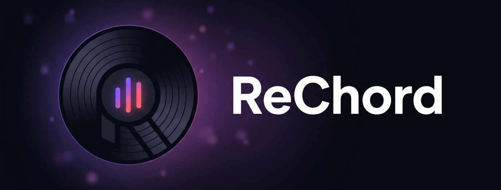
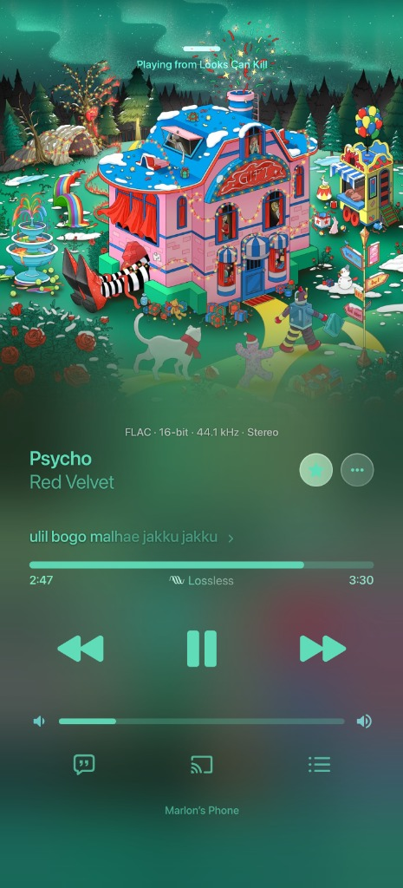
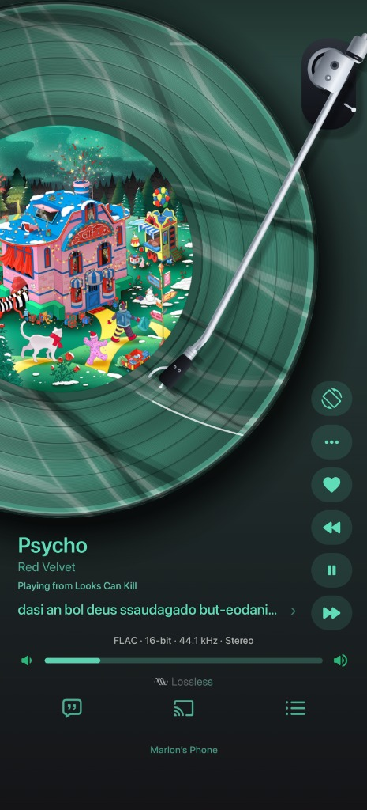
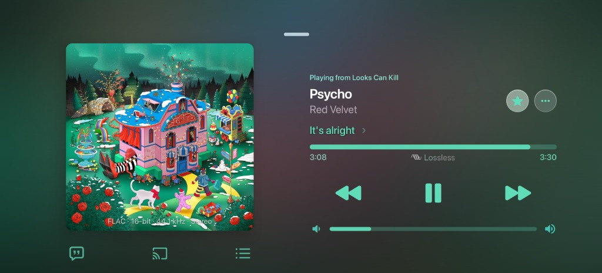
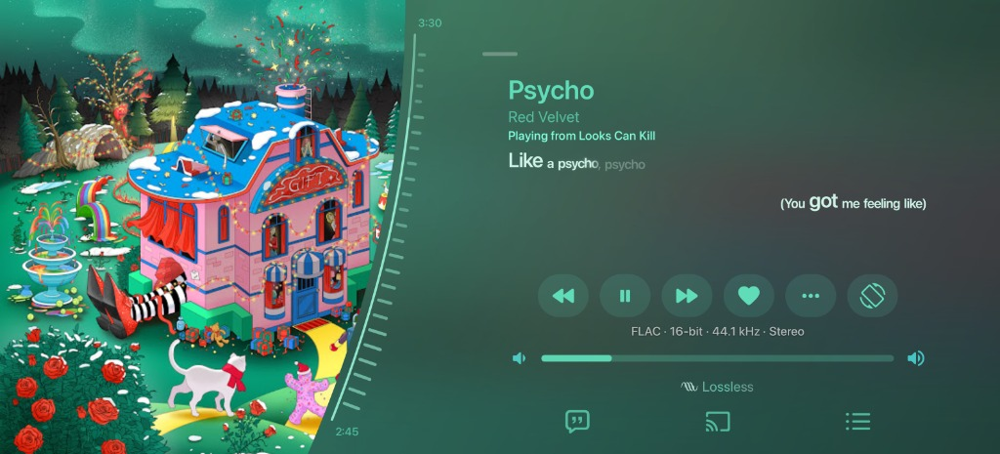
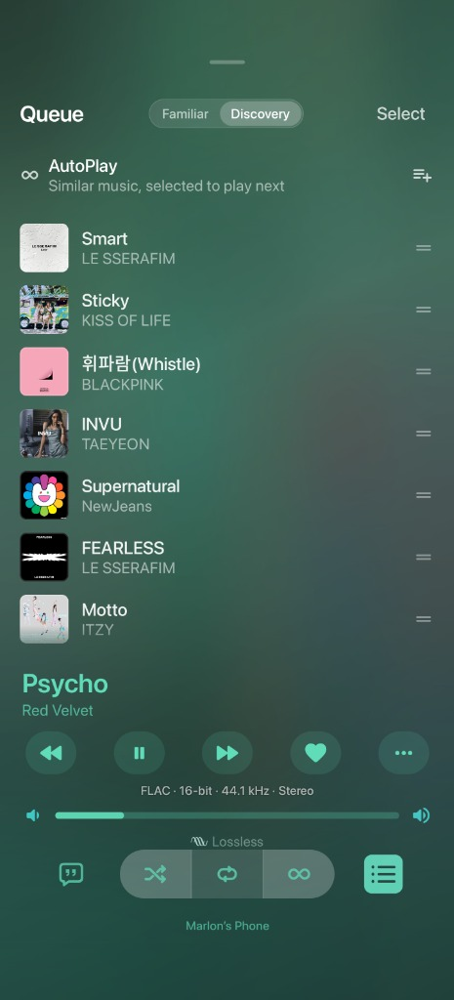
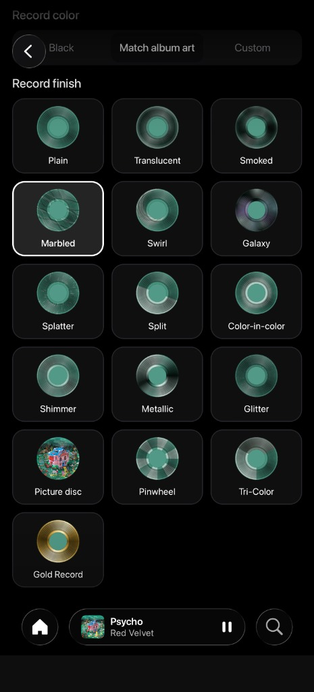
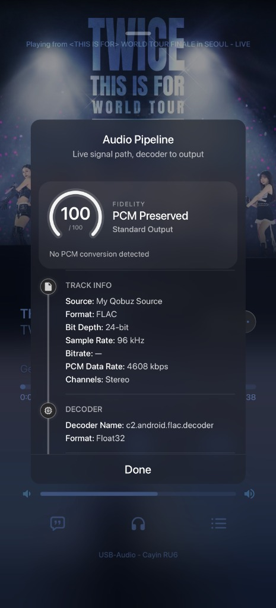
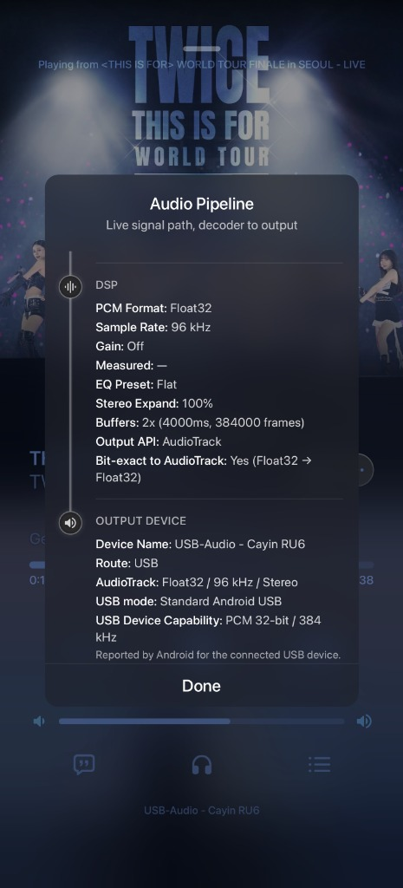

  
  

    
    
    
    
  

  

    <a href="https://github.com/dabestakoh/ReChord/releases">Releases</a> ·
    <a href="https://github.com/dabestakoh/ReChord/actions/workflows/preview-apk.yml">Preview Builds</a> ·
    <a href="https://github.com/dabestakoh/ReChord/issues">Issues</a> ·
    <a href="docs/RECHORD-STANDARDS.md">Engineering Standards</a>
  

**ReChord** is an Android music player for YouTube Music, local Hi-Res libraries, and open custom audio sources, forked from [BitChord](https://github.com/kushagrasinghx/BitChord).

ReChord is not affiliated with or endorsed by YouTube, Google, Spotify, Apple, Qobuz, or other music services.

---

## Screenshots

### Now Playing Skins

<table width="100%">
  <tr>
    <th align="center" width="33%">Default</th>
    <th align="center" width="33%">Vinyl</th>
    <th align="center" width="33%">Poster</th>
  </tr>
  <tr>
    <td align="center" width="33%"></td>
    <td align="center" width="33%"></td>
    <td align="center" width="33%"></td>
  </tr>
</table>

### Landscape

<table width="100%">
  <tr>
    <th align="center" width="33%">Default</th>
    <th align="center" width="33%">Vinyl</th>
    <th align="center" width="33%">Poster</th>
  </tr>
  <tr>
    <td align="center" width="33%"></td>
    <td align="center" width="33%"></td>
    <td align="center" width="33%"></td>
  </tr>
</table>

### Home, Queue &amp; Vinyl Studio

<table width="100%">
  <tr>
    <th align="center" width="33%">Home</th>
    <th align="center" width="33%">Queue (Familiar / Discovery)</th>
    <th align="center" width="33%">Vinyl Studio</th>
  </tr>
  <tr>
    <td align="center" width="33%"></td>
    <td align="center" width="33%"></td>
    <td align="center" width="33%"></td>
  </tr>
</table>

### Audio Pipeline &amp; Local Hi-Res

<table width="100%">
  <tr>
    <th align="center" width="33%">Fidelity Score</th>
    <th align="center" width="33%">USB DAC Pipeline</th>
    <th align="center" width="33%">Local Music</th>
  </tr>
  <tr>
    <td align="center" width="33%"></td>
    <td align="center" width="33%"></td>
    <td align="center" width="33%"></td>
  </tr>
</table>

---

## Highlights

| Area | Details |
| --- | --- |
| **Now Playing Skins** | **Default**, **Vinyl** (16 finishes + machined tonearm), and **Poster** (word-by-word lyrics + rim visualizer) with dedicated Portrait &amp; Landscape layouts. |
| **Discovery &amp; Queue** | **Familiar vs. Discovery** Autoplay, **Rediscover** picks, per-account durable taste memory, and queue add/remove learning with Undo. |
| **Lyrics &amp; Auto-Sync** | Per-song saved lyrics offset, one-tap Auto-sync with Undo, and multi-provider timing/language matching. |
| **Audio Pipeline &amp; DACs** | **Fidelity Score**, live Source → Decoder → DSP → Output view, Seamless Quality Upgrade (OPUS → FLAC), and **Direct USB (`libusb 1.0.30`)** with PCM Preserved reporting. |
| **Open Custom Add-Ons** | Compatible third-party add-on servers with no device attestation gate, bulk URL import, and Search Add-ons radio. |
| **Audio-First Video** | Watch synchronized music videos in the Default skin without downgrading lossless FLAC audio. |
| **Local Music &amp; Playlists** | Background-indexed Local Music (Hi-Res filter, A–Z jump rail), Apple Music / Spotify / YouTube Music link import, real-time playlist sync, and Liked Music reordering. |
| **Themes &amp; Performance** | True-black AMOLED &amp; Light themes, **Reduce Liquid Glass** and **Reduce Motion** support, and opt-in redacted Diagnostics export. |

---

## Installation

Download a signed build from [Releases](https://github.com/dabestakoh/ReChord/releases), or grab a testing build from the [Develop Preview workflow](https://github.com/dabestakoh/ReChord/actions/workflows/preview-apk.yml).

| Build | Android Package | Purpose |
| --- | --- | --- |
| **Release** (`prod` flavor) | `com.music.rechord` | Daily listening (signed production builds) |
| **Preview** (`dev` flavor) | `com.rechord.preview` | Testing upcoming changes; installs side-by-side with Release |

Preview and Release use separate app data. In-place updates require a matching signing certificate.

---

## Build from Source

1. Clone this repository and open it in Android Studio (Android SDK, NDK 27, JDK 17).
2. Configure signing in `keystore.properties` (see `keystore.properties.example`) for release builds.
3. Build `:app:assembleDevDebug` for Preview or `:app:assembleProdRelease` for Release.

See [ReChord Engineering Standards](docs/RECHORD-STANDARDS.md) and [Contributing Guide](CONTRIBUTING.md).

---

## Credits &amp; License

Based on [BitChord](https://github.com/kushagrasinghx/BitChord), with inspiration from [Auris](https://github.com/OreoMuncher45/Auris) and [Mochy Music](https://github.com/realidkroo/Mochy-Music).

Licensed under **GNU GPL-3.0**. See [LICENSE](LICENSE).
