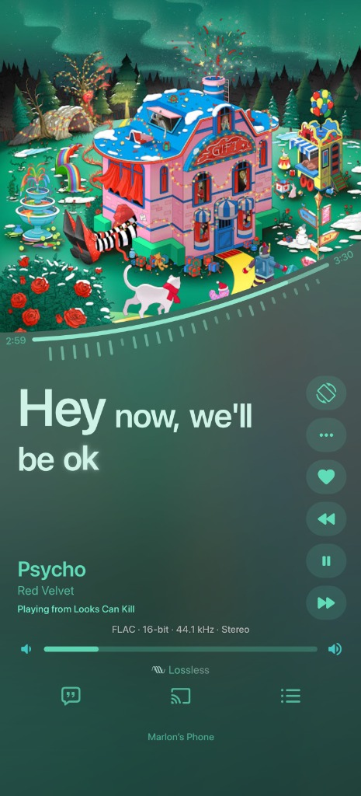
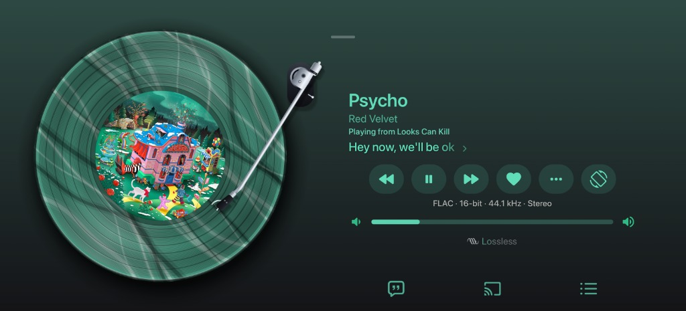
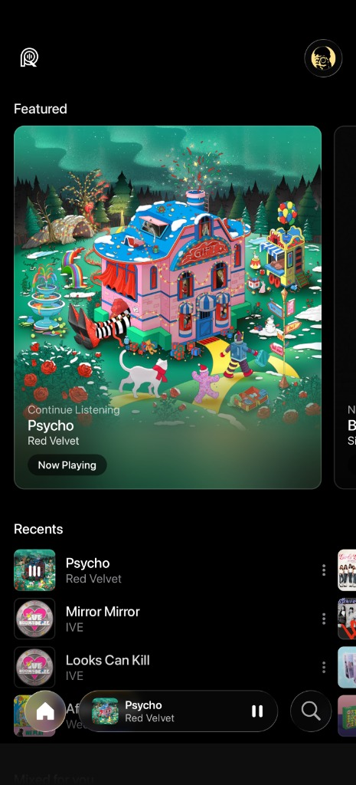
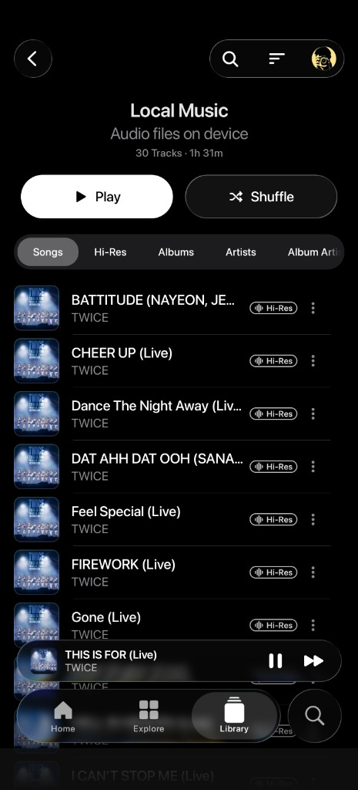

  
  
<strong>Music on your terms.</strong> A fast, audiophile-grade Android music player for YouTube Music, local Hi-Res libraries, and open custom audio sources.

  

    
    
    
    
  

  

    <a href="https://github.com/dabestakoh/ReChord/releases">Releases</a> ·
    <a href="https://github.com/dabestakoh/ReChord/actions/workflows/preview-apk.yml">Preview Builds</a> ·
    <a href="https://github.com/dabestakoh/ReChord/issues">Issues</a> ·
    <a href="docs/RECHORD-STANDARDS.md">Engineering Standards</a>
  

---

## About

**ReChord** is an independently maintained fork of [BitChord](https://github.com/kushagrasinghx/BitChord) focused on expressive Now Playing skins, lossless audiophile playback, smarter discovery and queue learning, accurate lyrics timing, open custom add-on support, and smooth low-power performance.

ReChord is not affiliated with or endorsed by YouTube, Google, Spotify, Apple, Qobuz, or other music services.

---

## Screenshots

### Now Playing Skins

<table width="100%">
  <tr>
    <th align="center" width="33%">Default</th>
    <th align="center" width="33%">Vinyl</th>
    <th align="center" width="33%">Poster</th>
  </tr>
  <tr>
    <td align="center" width="33%"></td>
    <td align="center" width="33%"></td>
    <td align="center" width="33%"></td>
  </tr>
</table>

### Widescreen Landscape (Phones, Tablets, DAPs &amp; Car Head-Units)

<table width="100%">
  <tr>
    <th align="center" width="33%">Default Landscape</th>
    <th align="center" width="33%">Vinyl Landscape</th>
    <th align="center" width="33%">Poster Landscape</th>
  </tr>
  <tr>
    <td align="center" width="33%"></td>
    <td align="center" width="33%"></td>
    <td align="center" width="33%"></td>
  </tr>
</table>

### Discovery, Smart Queue &amp; Vinyl Studio

<table width="100%">
  <tr>
    <th align="center" width="33%">Home &amp; Featured</th>
    <th align="center" width="33%">Queue (Familiar / Discovery)</th>
    <th align="center" width="33%">Vinyl Studio (16 Finishes)</th>
  </tr>
  <tr>
    <td align="center" width="33%"></td>
    <td align="center" width="33%"></td>
    <td align="center" width="33%"></td>
  </tr>
</table>

### Audiophile Pipeline &amp; Local Hi-Res Library

<table width="100%">
  <tr>
    <th align="center" width="33%">Fidelity Score (100/100)</th>
    <th align="center" width="33%">USB DAC Pipeline</th>
    <th align="center" width="33%">Local Music (Hi-Res)</th>
  </tr>
  <tr>
    <td align="center" width="33%"></td>
    <td align="center" width="33%"></td>
    <td align="center" width="33%"></td>
  </tr>
</table>

---

## What's Different from BitChord

| Area | ReChord Enhancements |
| --- | --- |
| **Now Playing Skins** | **3 dedicated skins** — **Default**, **Vinyl**, and **Poster** — each with tailored **Portrait &amp; Landscape** layouts, a quick **Rotate** button, smooth background color melts, and unified full-width Queue/Lyrics. |
| **Vinyl Studio** | **16 realistic pressed-vinyl finishes** (including *Pinwheel*, *Tri-Color*, *Picture Disc*, and *Gold Record*), live spinning preview, and a machined tonearm with soft shadow, progress peek, and pause needle lift. |
| **Expressive Poster** | Full-bleed edge-to-edge artwork, word-by-word expressive lyrics, curved seekbar, and an optional live **Curved Rim Visualizer**. |
| **Smart Discovery &amp; Queue** | **Familiar vs. Discovery** Autoplay modes, **Rediscover** picks, time-of-day taste awareness, durable per-account taste memory across restarts, and learning from Queue additions (**Play Next** / **Add to Queue**) and Autoplay removals (with **Undo**). |
| **Lyrics &amp; Auto-Sync** | **Per-song saved lyrics offset**, **one-tap Auto-sync** with Undo, expanded lyric animations (*Rise &amp; Glow*, *Shimmer Sweep*, *Word Lift*, *Plain Sweep*), and smarter multi-provider matching. |
| **Audiophile Pipeline &amp; USB DACs** | **Fidelity Score**, live **Audio Pipeline** view (Source → Decoder → DSP → Output Device), **Seamless Quality Upgrade** (OPUS → verified FLAC mid-track), **Direct USB (`libusb 1.0.30`)**, and verified **PCM Preserved / Bit-Perfect** reporting. |
| **Open Custom Add-Ons** | **No BitChord device attestation required** for compatible custom add-on servers. Supports **bulk add-on URL import**, Search Add-ons radio, and structured title/artist metadata while staying 100% compatible with query-only add-ons. |
| **Audio-First Video Mode** | Watch synchronized music videos in the Default skin **without downgrading lossless FLAC audio**, with automatic fallback when no video is available. |
| **Local Music &amp; Playlists** | Fast background-indexed **Local Music** (Songs, Hi-Res filter, Albums, Artists, Album Artists, Folders, Playlists, Recently Added + A–Z jump rail), **import public playlists by link** (Apple Music, Spotify, YouTube Music), real-time playlist cache sync, and Liked Music reordering. |
| **Performance &amp; Settings** | True-black AMOLED &amp; Light themes, **Reduce Liquid Glass** and **Reduce Motion** support across every layout, hardware-cached Vinyl layers, and opt-in redacted **Diagnostics** export. |

---

## Key Features

### Now Playing &amp; Skins
- **Default, Vinyl, and Poster skins** — Switch anytime from **Settings → Appearance → Now Playing Skin** or by long-pressing the top handle in Now Playing.
- **Dedicated Landscape layouts** — Rotating sideways opens tailored widescreen layouts across phones, tablets, DAPs, and car head-units.
- **Vinyl Studio** — Pick Black, Album-matched, or Custom dual-tone colors across 16 realistic finishes with pressed groove bands and beveled rims.
- **Audio-first Video Mode** — Play synchronized music videos alongside your existing high-resolution audio stream.

### Discovery, Queue &amp; Playlists
- **Familiar &amp; Discovery Autoplay** — Switch between comforting favorites and fresh similar tracks directly in Queue, or tap **Start Radio** on any track.
- **Durable Taste Learning** — Remembers likes, dislikes, early skips, dismissed Home cards, and queue intent separately for each account across restarts.
- **Instant Online Playlists &amp; Import** — Import public playlists from Apple Music, Spotify, and YouTube Music by link, pull down to refresh, and reorder tracks cleanly.

### Audiophile Playback &amp; USB DACs
- **Seamless Quality Upgrade &amp; FLAC Read-Ahead** — Upgrades OPUS to verified FLAC mid-track when supported and reuses complete verified FLAC caches on repeat plays.
- **Fidelity Score &amp; Audio Pipeline** — Inspect exact source format, decoder output, DSP path, connected USB DAC capabilities, and whether PCM is preserved.
- **Direct USB &amp; Android 14 USB** — Built-in `libusb 1.0.30` Direct USB support, automatic output precision, hardware volume restoration, and optional software volume.

*Available formats and output fidelity depend on the source, device, and playback path. Audio Pipeline reports bit-perfect USB output when it can verify that PCM is preserved.*

See [Releases](https://github.com/dabestakoh/ReChord/releases) for full version-by-version changelogs.

---

## Installation

Download a signed build from [Releases](https://github.com/dabestakoh/ReChord/releases), or grab a testing build from the [Develop Preview workflow](https://github.com/dabestakoh/ReChord/actions/workflows/preview-apk.yml) when an artifact is available.

| Build | Android Package | Purpose |
| --- | --- | --- |
| **Release** (`prod` flavor) | `com.music.rechord` | Daily listening (signed production builds) |
| **Preview** (`dev` flavor) | `com.rechord.preview` | Test upcoming changes; installs side-by-side with Release |

Preview and Release use separate application data. In-place APK upgrades require a matching signing certificate; do not uninstall a build containing unbacked-up data just to replace it.

---

## Build from Source

1. Clone this repository and open the Android project in Android Studio.
2. Install the Android SDK, NDK 27, and JDK 17 required by the project.
3. Configure signing in `keystore.properties` (see `keystore.properties.example`) for release builds.
4. Build `:app:assembleDevDebug` for Preview or `:app:assembleProdRelease` for Release.

For coding, UI, playback, and release conventions, see the [ReChord Engineering Standards](docs/RECHORD-STANDARDS.md) and [Contributing Guide](CONTRIBUTING.md).

---

## Credits &amp; License

ReChord is based on [BitChord by kushagrasinghx and contributors](https://github.com/kushagrasinghx/BitChord). Existing upstream copyrights and third-party attribution remain applicable.

- Thanks to [Auris](https://github.com/OreoMuncher45/Auris) for inspiring the Now Playing color treatment, startup skeletons, and smoother scrolling.
- Thanks to [Mochy Music](https://github.com/realidkroo/Mochy-Music) for inspiring the featured Home carousel, personalized recommendations, Vinyl and Poster players, expressive timed lyrics, expanded lyric effects, and synchronized Video mode.

Distributed under the **GNU General Public License v3.0**. See [LICENSE](LICENSE) for full license terms.

Music and metadata are supplied by independent providers. Use the software in accordance with applicable law and service terms.
